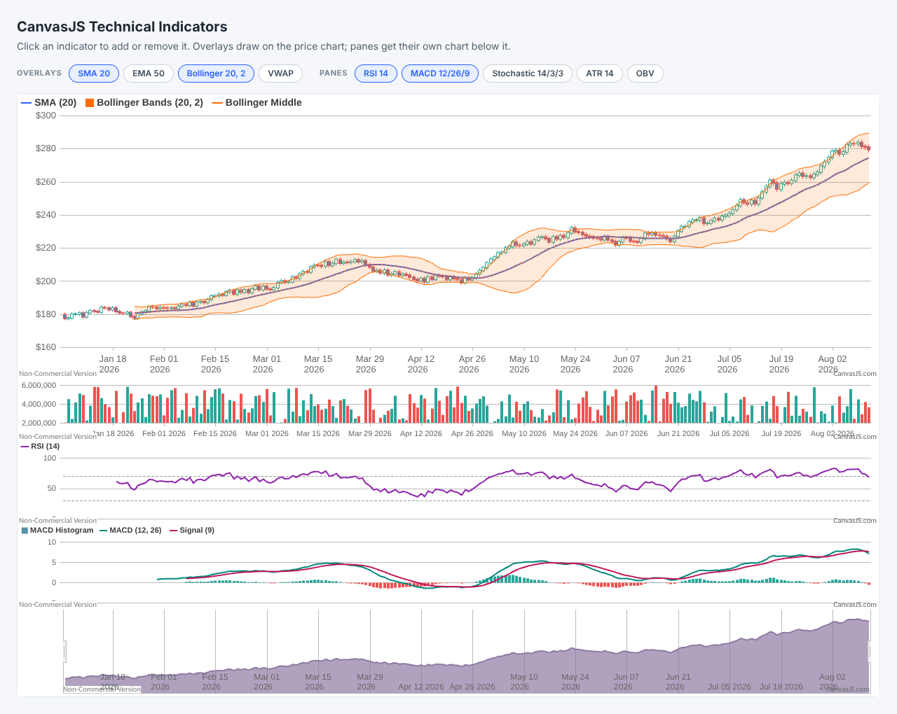

# CanvasJS Technical Indicators

Add RSI, MACD, Bollinger Bands and more to a [CanvasJS](https://canvasjs.com) Chart or StockChart with one option and one call. Nine indicators, one small file each, plain ES5, no dependencies.



```js
var stockChart = new CanvasJS.StockChart("chartContainer", {
  charts: [{ data: [{ type: "candlestick", dataPoints: candles }] }],
  indicators: [
    { type: "sma", period: 20 },
    { type: "bollinger", period: 20, standardDeviations: 2 },
    { type: "rsi", period: 14 },
    { type: "macd", fast: 12, slow: 26, signal: 9 }
  ]
});
stockChart.render();
TechnicalIndicators.apply(stockChart);   // adds the series and panes, renders once
```

- **Modular**: load only the indicators you use, or the single bundled file.
- **Built on CanvasJS, not around it**: the plugin reads the data points already in your chart options and writes ordinary CanvasJS series (and, in a StockChart, extra charts) back into the options. Nothing in CanvasJS is patched unless you opt in to `enable()`.
- **Chart and StockChart**: overlays (moving averages, bands, VWAP) work in both. Indicators that need their own chart (RSI, MACD, ...) work in a StockChart; in a plain Chart they are skipped with a console warning.
- **Realtime friendly**: change the data, call `update()`.
- **Matches your chart**: panes inherit the price chart's axis colours, fonts, tooltip and legend styling, so dark themes just work.

Try the [playground](examples/playground.html) (toggle indicators on a live StockChart), the [Chart example](examples/chart.html) and the [all-indicators example](examples/stockchart.html). They load CanvasJS from `cdn.canvasjs.com`; open them in a browser.

## Install

This repository does not include CanvasJS. Get it from [canvasjs.com](https://canvasjs.com) and check its license terms. The StockChart build includes the regular charts too.

```html
<script src="https://cdn.canvasjs.com/canvasjs.stock.min.js"></script>

<!-- everything in one file -->
<script src="https://cdn.jsdelivr.net/gh/vishwas-r/canvasjs-technical-indicators@1.0.0/dist/technical-indicators.min.js"></script>

<!-- or just what you need: the core first, then the indicators -->
<script src="src/technical-indicators-core.js"></script>
<script src="src/indicators/simple-moving-average.js"></script>
<script src="src/indicators/relative-strength-index.js"></script>
```

If you use the `dist` or `src` files from a clone instead of the CDN, copy them next to your page. An indicator whose file is not loaded logs `Unknown indicator "rsi". Load its file from the indicators folder.`

## Turn indicators on

Put an `indicators` array in the chart options (CanvasJS ignores options it does not know), then choose one:

| | How | Use it when |
|---|---|---|
| **A** | `TechnicalIndicators.apply(chart)` | The data is already in the options. Works with async data: call it after the data arrives. Returns a handle. |
| **B** | `TechnicalIndicators.options(chartOptions)` | You want the options with the indicators added before creating the chart. The data points must already be in the options. |
| **C** | `TechnicalIndicators.enable()` once | You want `indicators` to just work on every `render()`. Wraps `render()` on the Chart and StockChart prototypes, and recalculates when the data changes. `TechnicalIndicators.disable()` undoes it. |

The handle returned by `apply`:

```js
var indicatorSet = TechnicalIndicators.apply(stockChart);
indicatorSet.add({ type: "ema", period: 50 });   // returns its id ("ema"), renders
indicatorSet.remove("ema");
indicatorSet.update();                            // recalculate from the current data and render
indicatorSet.getIdentifiers();
indicatorSet.destroy();                           // remove every indicator it added
```

Ids default to the type (`"sma"`, then `"sma-2"`); set `id` to choose your own.

## Realtime

```js
dataPoints[dataPoints.length - 1].y = [open, high, low, newClose];   // or push a new candle
indicatorSet.update();
```

`update()` recalculates the whole series from the current data (fast enough for thousands of candles; incremental updates are on the roadmap). A StockChart keeps its zoom and navigator position across `update()`.

## Indicators

Defaults are in brackets. `source` is `"open"`, `"high"`, `"low"` or `"close"`.

| `type` | File | Where | Options |
|---|---|---|---|
| `sma` | `simple-moving-average.js` | overlay | `period` (20), `source` ("close") |
| `ema` | `exponential-moving-average.js` | overlay | `period` (20), `source` |
| `bollinger` | `bollinger-bands.js` | overlay | `period` (20), `standardDeviations` (2), `source` |
| `vwap` | `volume-weighted-average-price.js` | overlay | `reset` ("day" restarts every day for intraday bars; "none" for daily bars). Needs OHLC and volume |
| `rsi` | `relative-strength-index.js` | pane | `period` (14), `overbought` (70), `oversold` (30), `source` |
| `macd` | `moving-average-convergence-divergence.js` | pane | `fast` (12), `slow` (26), `signal` (9), `source`, `positiveColor`, `negativeColor` |
| `stochastic` | `stochastic-oscillator.js` | pane | `period` (14), `smoothing` (3), `signalPeriod` (3), `overbought` (80), `oversold` (20). Needs OHLC |
| `atr` | `average-true-range.js` | pane | `period` (14). Needs OHLC |
| `obv` | `on-balance-volume.js` | pane | none. Needs volume |

Options every indicator accepts: `id`, `color`, `options` (raw CanvasJS options merged into each generated series), and for panes `paneHeight` (default 120) and `paneOptions` (merged into the pane's chart options).

## Your data

- Candlestick or OHLC points (`y: [open, high, low, close]`) work for every indicator. Line and area points (`y: number`) work for the close-only ones (SMA, EMA, Bollinger, RSI, MACD).
- Volume comes from a `volume` property on each data point, or from a volume series: `volumeSeriesIndex` (plus `volumeChartIndex` in a StockChart).
- `seriesIndex` and `chartIndex` (both default 0) choose the price series.
- Give each candle its own `color`. In CanvasJS candlesticks, `risingColor` and `fallingColor` alone do not colour the candles.

## Chart or StockChart

- **Overlay** indicators are added to the price chart's `data` in either.
- **Pane** indicators become an extra chart in the StockChart's `charts` array. Give the container enough height: roughly 150px per pane on top of the price chart (the [playground](examples/playground.html) shows how to grow it as you add panes).
- In a plain Chart a pane indicator is skipped and the console says `TechnicalIndicators: rsi is supported only in StockChart`.

## Write your own indicator

An indicator is one object. This one is complete and tested (see `test/run-tests.js`):

```js
TechnicalIndicators.register({
  type: "donchian",
  name: "Donchian Channel",
  placement: "overlay",                // or "pane"
  requiresOhlc: true,
  requiresVolume: false,
  defaults: { period: 20 },
  integerParameters: ["period"],       // validated as whole numbers of at least 1
  calculate: function(candles, parameters) {
    var calculations = TechnicalIndicators.calculations;
    return {                           // arrays as long as candles, null where not defined yet
      upperBand: calculations.rollingExtreme(calculations.extractValues(candles, "high"), parameters.period, true),
      lowerBand: calculations.rollingExtreme(calculations.extractValues(candles, "low"), parameters.period, false)
    };
  },
  series: [                            // maps the arrays to CanvasJS series: line, column or rangeArea
    { type: "rangeArea", outputs: ["upperBand", "lowerBand"], colorIndex: 0, label: function(parameters) { return "Donchian (" + parameters.period + ")"; } }
  ]
});
```

Optional members: `validate(parameters)` (return a message to reject the options), `paneOptions(parameters)` (CanvasJS options for the pane's chart). Shared math lives in `TechnicalIndicators.calculations`: `simpleMovingAverage`, `exponentialSmoothing` (EMA and Wilder smoothing), `standardDeviation`, `rollingExtreme`, `trueRange`, `subtract`, `extractValues`.

## Accuracy

The test suite checks the maths, not just that charts draw: RSI is compared with an independent Wilder calculation (70.46 and 66.25 on the classic 20-close series; spreadsheet tutorials that show 70.53 round the average gain and loss first), MACD and Bollinger collapse correctly on flat prices, and OBV, ATR, Stochastic and VWAP have hand-checkable cases. Run them with `npm test` (Node 14 or newer, no dependencies). The same tests run against `src/`, `dist/technical-indicators.js` and the minified build.

## Browser support

The code is plain ES5: no transpiling, no `let`/`const`, arrow functions or other ES6 syntax, and none of the array methods missing from old IE. It was tested in Chromium; it needs no more than CanvasJS itself does.

## Roadmap

Incremental (last-bar) updates for very large datasets, ADX, CCI, Williams %R, MFI, Parabolic SAR, Supertrend, Ichimoku. Pull requests for any of these are welcome: see [CONTRIBUTING.md](CONTRIBUTING.md).

## Notes

- Indicators are calculated from the data you give the chart. Nothing here is financial advice.
- CanvasJS is a separate product with its own license; this project is not part of it and does not bundle it.

## License

[MIT](LICENSE)
